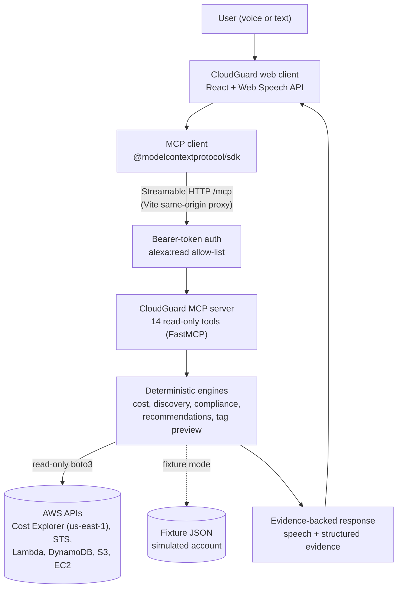
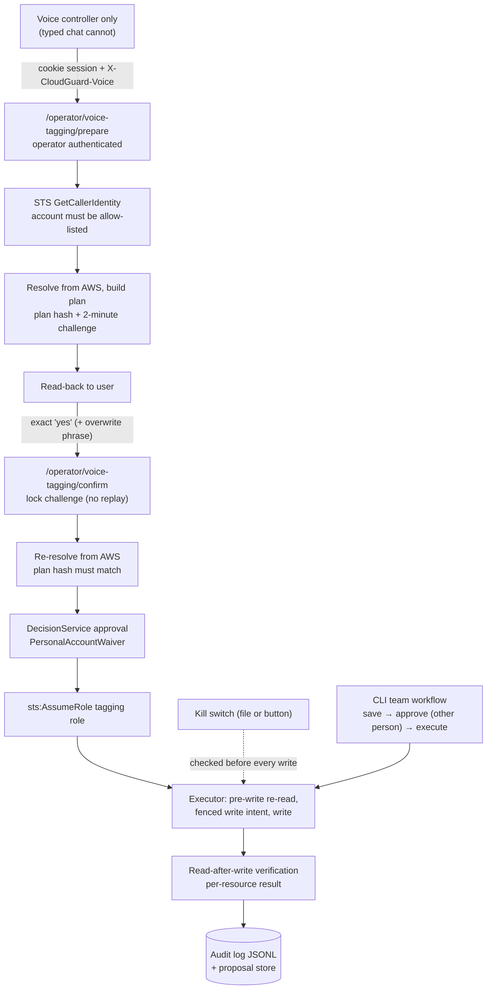

# CloudGuard AI

**Agentic investigation. Evidence-backed answers. Human-approved actions.**

CloudGuard AI is a conversational AWS governance and cost-intelligence assistant. You ask it about your AWS account by voice or text. It answers with deterministic, read-only AWS checks, shows the raw AWS evidence behind every answer, and changes nothing unless a person explicitly approves a tagging operation.

CloudGuard is exposed as a self-hosted **MCP server** (protocol 2025-11-25, Streamable HTTP). It is demonstrated through a **custom browser-based MCP client** with voice input and output.

> **What this is not**
> - It is **not** an Amazon product, and **not** an Alexa+ integration. The browser client authenticates with CloudGuard's *Alexa-scoped* token to show the surface an Alexa+ integration would get. No Alexa device, service or account linking is involved.
> - It does **not** use Amazon Bedrock, Amazon Nova or Strands Agents today. Answers come from deterministic code and fixed templates (see [Roadmap](#roadmap)).
> - It is **not** production-ready (see [Project status](#project-status)).

Built for the Amazon Developer Hackathon (Alexa+ track, AWS Builder mini challenge). Developer friction is recorded in [docs/FRICTION_LOG.md](docs/FRICTION_LOG.md).

---

## Problem

Small teams run AWS without a dedicated cloud or FinOps engineer, and the same questions keep coming up:
- **Spend is hard to read.** Bills mix usage, credits, tax and refunds, and "why did it go up?" takes several Cost Explorer views to answer.
- **Resources are hard to find.** They are spread across services and regions, and the console shows one region at a time.
- **Governance drifts.** Resources lose their `owner`, `project` or `environment` tags, so nobody knows who owns or pays for them.
- **Tagging policy is hard to keep consistent.** Tag keys are case-sensitive (`Owner` and `owner` are different tags), and values drift (`prod`, `Prod`, `production`).
- **Bulk changes are risky.** Tagging fifty resources by script can overwrite values, miss resources in regions you didn't scan, or run against the wrong account.

## Solution

CloudGuard combines four things:
1. **Conversational interaction:** questions by voice or text, with short spoken answers and visual detail.
2. **Deterministic AWS operations:** fixed, read-only AWS API calls decide every fact. Nothing is invented by a model.
3. **Governance analysis:** tag compliance against a versioned policy, untagged-resource reports and evidence-only tag recommendations.
4. **Human-approved actions:** the only write is tagging, and it runs only after a read-back, an explicit confirmation or approval, and read-after-write verification.

---

## Key features

Everything below is implemented in the current code. Where it has been verified is stated in [Testing](#testing) and [Current limitations](#current-limitations).

### Cost intelligence (read-only, AWS Cost Explorer and Cost Anomaly Detection)
Six MCP tools (`backend/cloudguard/server/cost_tools.py`):

| Tool | What it answers |
|---|---|
| `get_monthly_aws_bill` | A month's bill (last month by default), split into usage, credits, tax, discounts and refunds |
| `get_current_month_spending` | Month-to-date spending |
| `get_cost_breakdown` | Cost by service |
| `compare_monthly_costs` | Month-over-month comparison |
| `investigate_cost_increase` | Which services drove an increase (changes below one cent are never called drivers) |
| `get_cost_anomalies` | Cost Anomaly Detection results over a look-back window |

### Resource governance (read-only)
Seven MCP tools (`backend/cloudguard/server/governance_tools.py`):

| Tool | What it does |
|---|---|
| `get_resource_inventory` | Inventory by service and region, with discovery coverage |
| `search_resources` | Find resources by name (exact or contains) |
| `list_untagged_resources` | Resources missing required tags |
| `scan_tag_compliance` | Full compliance scan against the active tagging policy |
| `explain_finding` | The evidence behind one finding |
| `recommend_tags` | Tag values suggested only from evidence (e.g. sibling resources); nothing is applied |
| `preview_tag_changes` | Dry run of a tagging request: what would change, conflicts, overwrites. Stores and writes nothing |

Plus `get_aws_account_identity` (STS `GetCallerIdentity`). All **14 tools** are annotated `readOnlyHint=true`, `destructiveHint=false`. Discovery covers every enabled region (`ec2:DescribeRegions`) or a narrowed region and service scope. Scans are cached in memory for up to 5 minutes.

### Conversational bulk tagging
Example: *"Tag all Lambda functions containing CodeBridge in Mumbai with owner = alex."*

1. CloudGuard understands the request and **reads back its interpretation**. It continues only after a spoken "yes" (voice).
2. If no region was given, it **asks for one** (one region per tagging request).
3. It searches with `search_resources`, **reports the match count**, and **discloses incomplete discovery** if any region or service could not be read.
4. It asks for the tag key and value. If you gave one, it asks **only for the missing one**, and keeps the conversation context.
5. It shows a **preview**: matched, to change, already correct, left unchanged (with reasons) and overwrites (old → new). **Case-sensitive key conflicts** (`Owner` vs `owner`) are explained, and those resources are not changed.
6. It needs **confirmation**: "yes", plus "I confirm the overwrite" when existing values would change.
7. The server **re-checks everything against AWS**, executes, **reads every resource back**, and reports *tagged and verified*, *already correct*, *skipped* and *failed*. A resource that fails verification is never counted as tagged.

There are two ways an approved change can be executed:

| Mode | Who approves | Where |
|---|---|---|
| **Team workflow** (default) | A *different* person approves the proposal's content hash; someone other than the approver executes | CLI: `proposal save` → `proposal approve` → `proposal execute --mode live` ([docs/live-tagging.md](docs/live-tagging.md)) |
| **Personal Voice Tagging Mode** (opt-in, off by default) | One operator, in their own allow-listed development account; separation of duties is deliberately waived for that account only | Voice only, through `/operator/voice-tagging/*` after operator sign-in ([docs/voice-tagging.md](docs/voice-tagging.md)) |

**Typed chat cannot write to AWS.** It reaches only `preview_tag_changes`, then hands over CLI commands. **No MCP tool writes**, and the MCP and Alexa tokens cannot reach `/operator`.

### Voice assistant (browser Web Speech API, Chrome/Edge)
- Speech recognition with selectable **en-IN / en-US / en-GB**. The default follows the browser language and time zone.
- **Interim vs final text:** interim-only speech never confirms, cancels, answers a pending question or starts a tagging request.
- **Low-confidence warning:** below 0.6 confidence, the read-back says "I'm not sure I heard that correctly".
- **Read-back before discovery** for tagging, and a **"Misheard? Correct the request"** form. A corrected request is still read back and still needs a spoken yes.
- **Speech output** with a managed lifecycle: no overlapping speech, a fallback if the browser never signals the end, and the microphone opens only after speaking has finished.
- No custom vocabulary or grammar biasing. Technical terms can be misheard, and the read-back is the safeguard.

### Region clarification
- "List all Lambda functions" → *"Which AWS region should I search?"* → "Mumbai" → searches `ap-south-1`. The original request is kept while CloudGuard waits for the answer.
- Region IDs and about 20 city or region names are accepted. Ambiguous names ("Europe") get a follow-up question, and unknown places are rejected. An explicit region skips the question.
- "All regions" is offered only where the tool's schema accepts it. "What about Singapore?" re-runs the last listing there, and a stale answer for the old region is dropped.

### MCP integration
- **Server:** Python `mcp` SDK (FastMCP), stateless Streamable HTTP, protocol 2025-11-25.
- **HTTP deployment prototype** (`python -m cloudguard.deploy`): bearer-token auth with SHA-256 digests. An `alexa:read` scope limits the Alexa token to the 14 read-only tools and to voice-friendly response projections, and the server refuses to start if that surface is inconsistent. Not deployed.
- **Browser client:** the official MCP TypeScript SDK (`initialize`, `tools/list`, `tools/call`). It reaches the server through a same-origin Vite proxy.

### Dashboard (web client)
Eight pages behind a collapsible sidebar (`web/src/pages/`, `web/src/components/Shell.tsx`). All data comes from live MCP tool calls; there is no hard-coded demo data.

| Page | Content |
|---|---|
| Overview | Account summary, spend and governance status, discovery coverage |
| Cost Intelligence | The six cost tools. In live mode each Cost Explorer panel loads on click, because each request is billed |
| Resource Governance | Inventory, compliance and untagged resources, with coverage warnings |
| Voice Assistant | Voice and text conversation, discovery stage tracker, conversation history, voice tagging panel |
| Tag Management | Tagging preview form, untagged resources, voice tagging results |
| Activity & Audit | Session history of voice turns and executions, kept separate from the durable audit log |
| Settings | Connection, data mode, recognition language, operator session, cache |
| MCP Explorer | Call any discovered tool directly (developer view) |

The top bar shows MCP connection (server, protocol, tool count), **Fixture / Live AWS** mode (from `/healthz`), preferred region, operator session and kill-switch state. A redesigned connect screen handles the token, and the layout is responsive down to phone width.

---

## Architecture



Controlled tagging execution runs on a separate path that MCP cannot reach:



---

## Technology stack

Versions are as declared in `backend/pyproject.toml` and `web/package.json`.

| Area | Technology |
|---|---|
| Backend language | Python (`requires-python >=3.12`; developed on 3.14) |
| Backend packaging | uv (`backend/uv.lock`), hatchling build backend |
| MCP server | `mcp>=1.29,<2` (FastMCP, Streamable HTTP) |
| AWS SDK | `boto3>=1.40` (standard retry mode) |
| Models / validation | `pydantic>=2.9` |
| Declared but unused | `strands-agents>=1.60` (no code imports it yet) |
| Backend tests | `pytest>=8.3`, `moto[dynamodb]>=5`, botocore `Stubber` |
| Frontend | React 18.3.1, TypeScript 5.6.3, Vite 5.4.11 (`@vitejs/plugin-react` 4.3.4) |
| MCP client | `@modelcontextprotocol/sdk` 1.29.0 |
| Voice | Browser Web Speech API (`SpeechRecognition`, `speechSynthesis`) |
| Frontend tests | Vitest 2.1.8, Playwright 1.49.1 |
| Authentication | Static bearer tokens (SHA-256 digests) for MCP. Operator credential + HttpOnly SameSite=Strict cookie for voice tagging. AWS identity via STS. **No OAuth** |
| Infrastructure (not deployed) | CloudFormation (`infra/`), proposed IAM policies (`infra/iam/`), Lambda Web Adapter prototype (`backend/deploy/lambda/`) |

---

## Supported AWS services and resource types

| Capability | Supported |
|---|---|
| Resource discovery / inventory / search | Lambda functions, DynamoDB tables, S3 buckets, EC2 instances |
| Tag compliance | Same four types |
| Tag recommendations | Same four types (evidence only, nothing applied) |
| Tagging preview | Same four types |
| **Live tagging execution** | Lambda (`TagResource`), DynamoDB (`TagResource`), EC2 **instances only** (`CreateTags`), S3 (`PutBucketTagging`, read-merge-write). **Implemented and tested offline only; never run against real AWS** |
| Cost | Cost Explorer `GetCostAndUsage`, Cost Anomaly Detection `GetAnomalyMonitors` / `GetAnomalies` (single `us-east-1` endpoint) |
| Identity | STS `GetCallerIdentity`; `AssumeRole` for the voice tagging role |

Other EC2 resources (volumes, snapshots, security groups) and other services are not supported.

---

## Getting started

### Prerequisites
- Python 3.12+ (3.14 used in development) and [uv](https://docs.astral.sh/uv/)
- Node.js 20+ and npm
- Chrome or Edge for voice
- For live mode only: AWS credentials with the read-only permissions in `infra/iam/` (see [docs/aws-permissions.md](docs/aws-permissions.md))

### 1. Clone and install
```bash
git clone https://github.com/mukeshkumar06/CloudGuard.git
```
```bash
cd CloudGuard/backend && uv sync
```
```bash
cd CloudGuard/web && npm install
```
On Windows, `npm install` may need `COMSPEC` set to `C:\Windows\System32\cmd.exe`. If `uv` isn't on PATH, use `backend\.venv\Scripts\python.exe`.

### 2. Create tokens (never commit them)
Run this twice: once for the server token and once for the Alexa-scoped token used by the browser. Keep the tokens, and put only the printed SHA-256 digests in the environment.
```bash
python -c "import secrets,hashlib;t=secrets.token_urlsafe(32);print(t);print(hashlib.sha256(t.encode()).hexdigest())"
```

### 3. Start the backend in fixture mode (synthetic data, no AWS calls)
In PowerShell, from `backend/`:
```powershell
$env:CLOUDGUARD_MODE = "fixture"
$env:CLOUDGUARD_TOKEN_SHA256 = "<server token sha256>"
$env:CLOUDGUARD_ALEXA_TOKEN_SHA256 = "<alexa token sha256>"
.venv\Scripts\python.exe -m cloudguard.deploy --port 8080
```
`GET http://127.0.0.1:8080/healthz` reports the mode.

### 4. Start the web client and connect
```bash
cd web && npm run dev
```
Open http://127.0.0.1:5173, keep the URL `/mcp`, paste the **Alexa** token, and click **Connect**. Vite proxies `/mcp`, `/healthz` and `/operator` to `CLOUDGUARD_MCP_TARGET` (default `http://127.0.0.1:8080`).

### Other entry points
- Local MCP server without auth (binds `127.0.0.1`): `python -m cloudguard.server [--transport stdio|streamable-http]`
- Governance CLI: `python -m cloudguard.governance scan --mode fixture`, plus `tag`, `proposal`, `authz` (see [CLAUDE.md](CLAUDE.md))
- Cost CLI: `python -m cloudguard.cost`

### Live mode prerequisites
`CLOUDGUARD_MODE=live` uses the server process's own AWS credentials for **read-only** calls. You need:
- the discovery permissions (`infra/iam/governance-discovery-policy.json`) and Cost Explorer permissions ([docs/cost-intelligence.md](docs/cost-intelligence.md));
- Cost Explorer enabled. Each Cost Explorer request is billed by AWS.

Personal Voice Tagging Mode additionally needs an allow-listed development account, a tagging role and a live allow-list. Follow [docs/voice-tagging-live-setup.md](docs/voice-tagging-live-setup.md). **That setup has not been verified against real AWS.**

---

## Configuration

Names only; never commit values. Tokens are configured as SHA-256 digests.

| Variable | Required | Purpose |
|---|---|---|
| `CLOUDGUARD_MODE` | optional (default `fixture`) | `fixture` or `live` |
| `CLOUDGUARD_TOKEN_SHA256` | **required** for `cloudguard.deploy` | Digest of the server (operator) MCP token |
| `CLOUDGUARD_ALEXA_TOKEN_SHA256` | optional | Digest of the Alexa-scoped token used by the browser client |
| `CLOUDGUARD_TOKEN_SUBJECT`, `CLOUDGUARD_TOKEN_SCOPES` | optional | Subject and scopes for the server token |
| `CLOUDGUARD_AUTH_MODE` | optional (default `static-token`) | `oauth` is refused: not implemented |
| `CLOUDGUARD_ALLOWED_HOSTS` | optional | Extra allowed Host headers |
| `CLOUDGUARD_POLICY_STORE`, `CLOUDGUARD_FIXTURE` | optional | Policy store location; fixture file |
| `CLOUDGUARD_CE_MAX_PAGES` | optional (default 5) | Cap on Cost Explorer pagination |
| `PORT` | optional (default 8080) | HTTP port for `cloudguard.deploy` |
| `CLOUDGUARD_VOICE_TAGGING_ENABLED` | **feature flag** (off by default) | `true` enables Personal Voice Tagging Mode |
| `CLOUDGUARD_VOICE_OPERATOR_TOKEN_SHA256` | required when voice tagging is enabled | Digest of the operator credential (must differ from both MCP tokens) |
| `CLOUDGUARD_VOICE_TAGGING_ACCOUNTS` | required when voice tagging is enabled | Allow-listed development account IDs |
| `CLOUDGUARD_VOICE_TAGGING_ROLE_ARN` | required in live voice tagging | Tagging role to assume |
| `CLOUDGUARD_VOICE_TAGGING_KILL_FILE`, `CLOUDGUARD_VOICE_TAGGING_STORE`, `CLOUDGUARD_VOICE_OPERATOR_SUBJECT`, `CLOUDGUARD_VOICE_SESSION_TTL_SECONDS` | optional | Kill-switch file, store and audit directory, operator name, session lifetime |
| `CLOUDGUARD_AUTHZ_BOOTSTRAP_ADMIN` | first allow-list save only | Bootstrap admin for `authz save` |
| `CLOUDGUARD_MCP_TARGET` | optional (web, `.env`) | Backend URL for the Vite proxy |
| `CLOUDGUARD_IT_REGION`, `CLOUDGUARD_IT_PROFILE` | tests only | Opt-in live integration tests |

---

## Security model

| Control | Implementation | Live-verified? |
|---|---|---|
| MCP is read-only | All 14 tools read-only; no MCP tool writes, saves, approves or executes | Tested offline; MCP server not run against live AWS |
| MCP authentication | Static bearer tokens compared by SHA-256 digest; `alexa:read` scope limited to an explicit tool allow-list | Offline only |
| Operator authentication | Separate operator credential → HttpOnly, SameSite=Strict cookie scoped to `/operator`; Host/Origin checks; session TTL | Offline only |
| AWS account verification | STS `GetCallerIdentity` at prepare and again at confirm; account must be allow-listed | Offline only |
| IAM role assumption | `sts:AssumeRole` into the tagging role (`cg-proposal-voice-*` sessions, 900 s); role must be in an allow-listed account | **Never run**; role not deployed |
| Approval model | Team: content-hash approval by a different person, executor ≠ approver, approvals expire (15 min default). Personal mode: server-side approval with an explicit per-account waiver | Offline only |
| Voice confirmation | Server accepts only exact affirmative phrases; interim, partial or vague replies never confirm | Faked speech in tests; no real microphone |
| Plan-hash binding | Hash over account, region, request, and every resource's current tags and changes; re-resolved from AWS before writing | Offline only |
| Challenge expiration | 2 minutes, bound to the operator session; a new request cancels earlier ones | Offline only |
| Replay protection | Challenge locked and moved to EXECUTING once; replays return the stored result; idempotency keys | Offline only |
| Overwrite confirmation | Separate "I confirm the overwrite" (voice) or `--acknowledge-overwrites` (CLI); adds never overwrite | Offline only |
| Kill switch | Kill file or UI button; checked on every request and before every write | Offline only |
| Audit logging | `voice-tagging-audit.jsonl` plus proposal, decision and execution records; no credentials, tokens or AWS error messages logged | Offline only |
| Read-after-write verification | Every resource re-read before and after its write; `FAILED_VERIFICATION` is reported, never counted as success | Offline only |
| Untrusted input | Resource names, tags and policy text are treated as data; `aws:` and `cloudguard:` keys refused | Offline only |

---

## Testing

Results from runs on 2026-10-23 (Windows, fixture or mocked AWS only):

| Suite | Command | Result |
|---|---|---|
| Backend (unit, fixture, mocked AWS: Stubber, moto, fakes) | `cd backend; uv run pytest` | 2,169 passed, 3 skipped, 0 failed (≈10.6 min). An earlier run had 1 intermittent failure, see Limitations |
| Web unit tests (Vitest, speech APIs faked) | `cd web; npm test` | 733 passed (22 files) |
| Playwright E2E (starts its own fixture backend and Vite server; speech faked) | `cd web; npm run test:e2e` | 46 passed |
| Type checking | `cd web; npm run typecheck` | Passed |
| Production build | `cd web; npm run build` | Passed (bundle-size warning: a 645 kB chunk) |
| Live AWS integration (read-only, opt-in) | `CLOUDGUARD_IT_REGION=ap-south-1 uv run pytest -m integration` | Not run in this update |

Levels of evidence, kept separate:
- **Fixture tests:** simulated account and fixture MCP backend. These are the bulk of the coverage.
- **Simulated speech:** Web Speech APIs replaced by fakes. No real-microphone test is recorded.
- **Mock AWS:** Stubber, moto and fakes for the live writer and voice tagging.
- **Read-only live AWS:** resource discovery (2026-10-20, 18 regions) and a reported Cost Explorer CLI run (2026-10-16). The MCP server itself has not been run against live AWS.
- **Live AWS writes:** **none performed.**

---

## Current limitations

- **Speech recognition:** browser-dependent (Chrome/Edge), no custom vocabulary, and technical terms are misheard. Real-microphone accuracy is unverified.
- **Speech output:** volume stability with Windows audio ducking and Bluetooth headsets is unverified on real hardware.
- **Regions:** tagging works in **one region at a time**.
- **Incomplete discovery** is disclosed but does **not block** tagging of the resources that were found.
- **Live AWS:** no live tag write has ever been performed. The tagging role, the CloudFormation stacks and the HTTP deployment are not deployed. The MCP server has not been run against live AWS.
- **Backend tests:** `test_cached_scans_are_never_shared_across_accounts` failed once in an earlier full-suite run and passed in the 2026-10-23 run. Its timing-dependent clock mix is not fixed, so it remains open (FL-022 in the friction log).
- **Integrations not built:** Alexa+ (no access), OAuth / account linking, Amazon Bedrock / Nova / Strands agents, security checks (S3 public access, IAM, security groups) and cost-waste checks (EBS, EIP, snapshots).
- Voice-tagging sessions and challenges live in server memory (one process; a restart signs out). At most 50 resources per confirmation.
- S3 tagging is read-merge-write (AWS replaces the whole tag set), and AWS tagging APIs have no conditional writes. See [docs/live-tagging.md](docs/live-tagging.md).

---

## Roadmap

**Completed (offline / fixture verified)**
- Cost intelligence: 6 MCP tools and a cost CLI
- Governance: multi-region discovery, compliance, versioned policies, search, untagged report, recommendations, tagging preview
- Proposal, approval and authorization workflow (CLI), fixture executor and live tag writer (offline-tested)
- Personal Voice Tagging Mode with operator authentication, challenges, kill switch and audit
- MCP server (14 read-only tools), HTTP prototype with an Alexa-scoped surface
- Browser MCP client: voice, region clarification and an eight-page dashboard

**In progress**
- Live AWS verification: a first live tag write on a throwaway resource, and the MCP server in live mode
- Fixing the intermittent scan-cache test
- Real-microphone and audio testing

**Planned**
- Amazon Bedrock (Nova Lite for development) with Strands Agents for explanations and prioritisation; deterministic checks keep deciding findings
- Security and cost-waste checks
- Deployment (Lambda Web Adapter prototype), OAuth, and an Alexa+ integration if access becomes available
- Multi-region tagging in one request

---

## Project status

**Hackathon prototype.** The read paths are implemented and well covered by offline tests, and some have been exercised read-only against a real account. The write path (tagging) is implemented with layered safeguards but has **only been tested against mocks and a simulated account**. CloudGuard is **not production-ready**. Do not point the write path at an account you care about until it has been verified live on a throwaway resource.

## Repository layout
- `backend/`: Python MCP server, cost and governance engines, voice tagging, CLI, tests
- `web/`: browser MCP client and dashboard ([web/README.md](web/README.md))
- `infra/`: CloudFormation and proposed IAM policies (not deployed)
- `docs/`: friction log, design and setup documents

## Contributing

Issues and pull requests are welcome. Before you open a PR:
- run the backend tests and the web unit, E2E and typecheck commands above;
- keep AWS access read-only except for approved tagging;
- never commit credentials, tokens or `.env` files;
- record any AWS tooling friction in [docs/FRICTION_LOG.md](docs/FRICTION_LOG.md).

## License

MIT. See [LICENSE](LICENSE).
